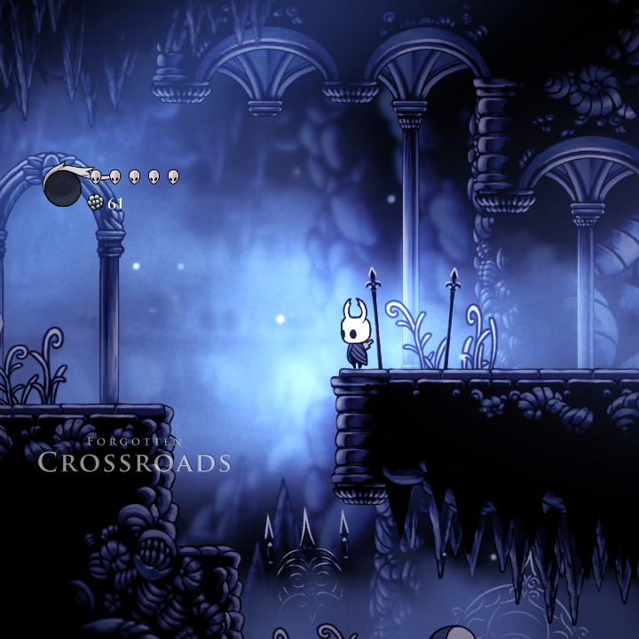
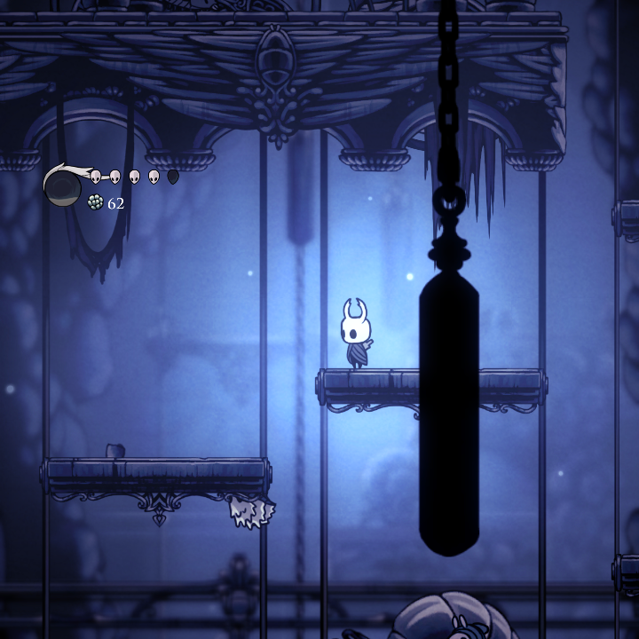
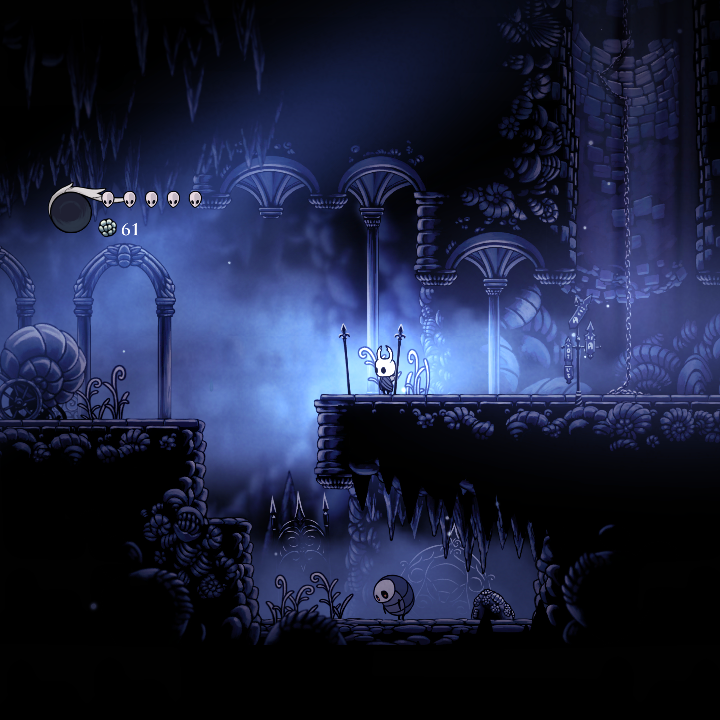
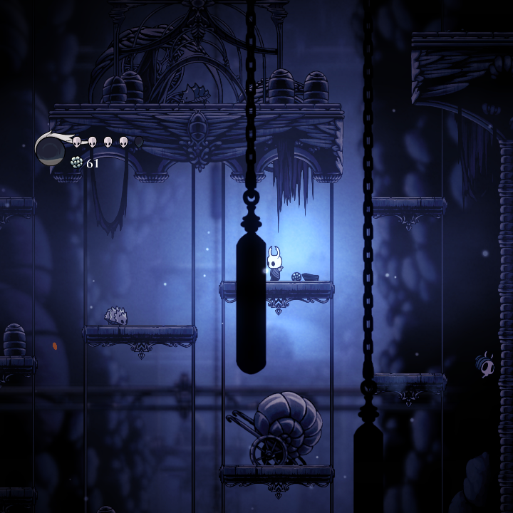

# Hollow Knight 1:1 Aspect Ratio Fix (Anbernic RG Rotate / Cube)

This is a modified version of the 4:3 HUD fix mod code created by u/SqueezyBotBeat from their 4:3 conversion (from [here](https://www.reddit.com/r/HollowKnight/comments/1n1qqv8/modified_hollow_knight_to_43_with_no_stretch/)). This is almost entirely their code I just edited some of the values on the DLL to work for the Rotate's 1:1 screen lol. All credit goes to them.

I did this mainly so I didn't have to choose between massive letterboxing with forcing 16:9 or having almost all the UI and HUD cut off at the sides with the dynamic scaling. It is designed for [Team Spore](https://discord.gg/FDVnHWcBZQ)'s Hollow Knight Android Port.

In **Video** settings I highly recommend setting: 

- **Particle Effects** to *Low* 
- **Blur Quality** to *Low* 
- **Fullscreen** to *On* (By default it's set to *Borderless*)

In **Advanced** I also suggest:

- **Shader Quality** to *Medium*
- **Frame Rate Cap** to *60*
- **Level of Detail** to *Medium*
- **Black Bars** to *Off*  

---

## Mod Options

### 1. Full Fidelity Version (`HK.RotateFixFullFidelity`) 
* **How it works:** Give you the same horizontal FOV as you'd get on a regular 16:9 aspect ratio.
* **Pros:** You get massive visual coverage of the environment, and it prevents room camera borders from cutting off parts of the map.
* **Cons:** Text boxes and menus scale down, which can make dialogue harder to read on small screens. Might also be a bit harder on the CPU

### 2. Regular / Zoomed In Version (`HK.RotateFix`)
> [!WARNING]
> Due to the camera issues, I massively recommend Full Fidelity until it is fixed!
* **How it works:** Zooms in the camera to make it the scaling more similar to the original experience at the expense of less FOV.
* **Pros:** The Knight, text boxes, and dialogue menus are larger, making the display less overwhelming and easier to read.
* **Cons:** Because of hardcoded Unity room camera boundaries, certain edges of rooms can get completely cut off, which can really make it frustrating as hell to figure out where entrances and exits are

---

## Installation & Setup

1. Clone/Download and extract this repo either on device or on your PC.
2. Choose **one** of the two mod folders depending on your preference:
   * **For maximum FOV:** Grab the `HK.RotateFixFullFidelity` folder.
   * **For less FOV and more readable text:** Grab the `HK.RotateFix` folder.
3. Transfer the chosen folder directly into your Android device's local mod folder path using MTP, ADB, or just files if you're doing it all on your device:
   `Android/data/com.TeamCherry.HollowKnight/files/Mods/`
4. Boot up the game, ensure you see **RotateFixMod : 1.0** or **RotateFixFullFidelityMod : 1.0**.

---

## Screenshots & Comparisons

### Regular (Zoomed In) View

**Forgotten Crossroads Entrance:**

**Forgotten Crossroads Vertical Shaft:**

---

### Full Fidelity View

**Forgotten Crossroads Entrance:**

**Forgotten Crossroads Vertical Shaft:**

---

This mod has only been tested on a RG Rotate running GammaOS Next 1.4.1. However since the Cube (NOT The CubeXX!!) has the same screen resolution and aspect ratio it should run about the same.